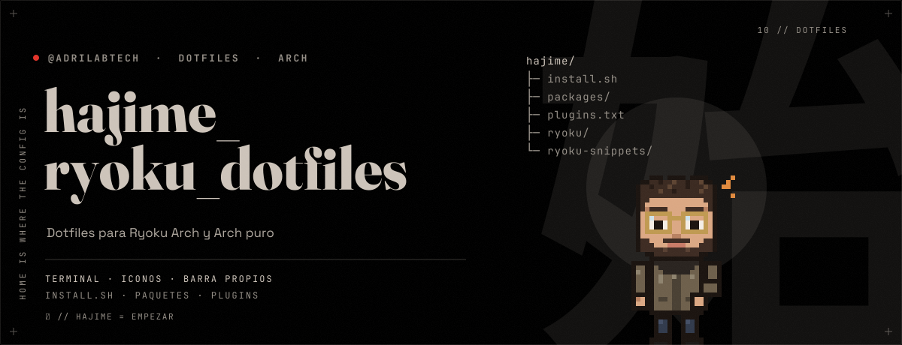
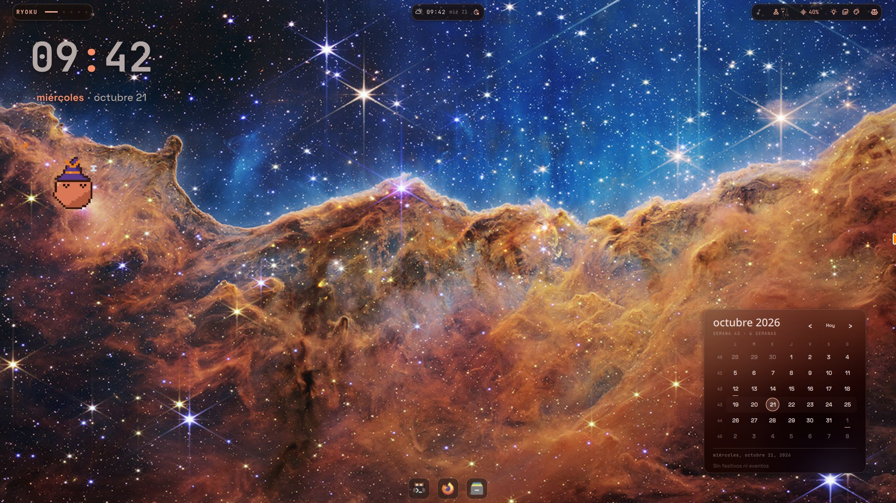
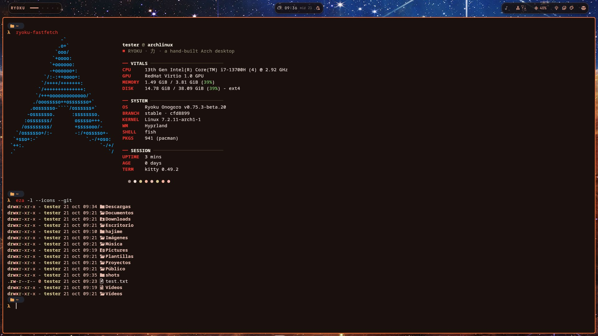
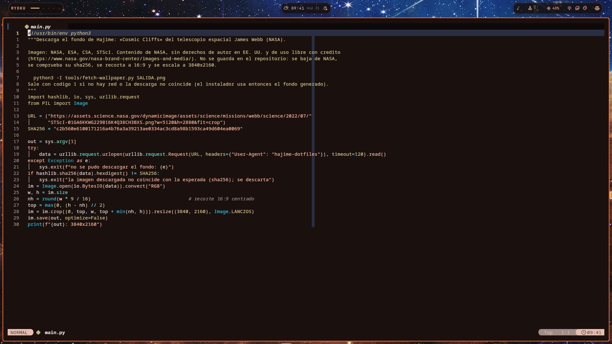
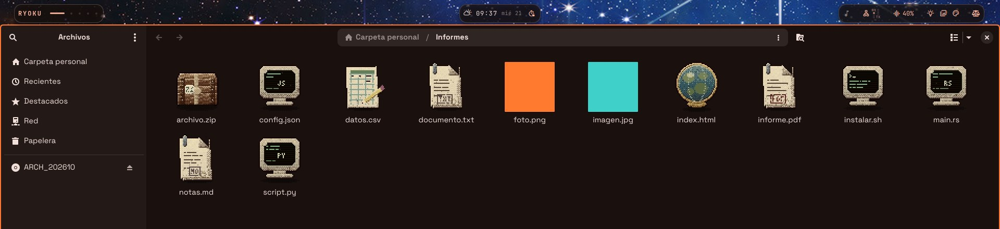

<p align="center"></p>

# Hajime

Dotfiles para **Ryoku Arch** y **Arch puro**: un escritorio oscuro y cálido, con terminal, iconos y barra propios.



<table>
<tr>
<td></td>
<td></td>
</tr>
</table>



## Instalar

| Tu sistema | Comando |
|---|---|
| Ya usas Ryoku | `./install.sh` |
| Arch puro | `./install.sh --arch` |

```
./install.sh --dry-run     # ver qué haría
./install.sh --uninstall   # quitar lo instalado (el escritorio anterior queda en Ryoku Hub > Rices > pre-hajime)
```

> **Arch puro.** `--arch` instala antes **Ryoku** con su convertidor oficial: hace `pacman -Syu` y cambia a SDDM y NetworkManager. Muestra el plan y pide confirmación. Como el convertidor usa `sudo` sin preguntar, crea un `/etc/sudoers.d/99-hajime-install` temporal y **lo borra al terminar**, también si falla. Solo x86_64 con systemd.

## Qué incluye

- **Rice Hajime:** fondo *Cosmic Cliffs* (telescopio Webb), barra en islas, ventanas *scrolling* sin sombras, dock que se oculta, sin visualizador.
- **Terminal:** logo de Arch en ASCII girando sin parar (kitty), prompt starship.
- **Iconos pixel art** para GTK, Qt y terminal, generados al instalar.
- **nvim** con aspecto propio y el widget **claude-companion**.

El fondo se descarga de NASA y los iconos se generan al instalar.

## Créditos

Fondo: NASA, ESA, CSA, STScI. Iconos derivados de [Papirus](https://github.com/PapirusDevelopmentTeam/papirus-icon-theme) (GPL-3.0). El logo de Arch es marca registrada de sus propietarios; aquí solo se lee del sistema.

GPL-3.0-or-later, como Ryoku.
